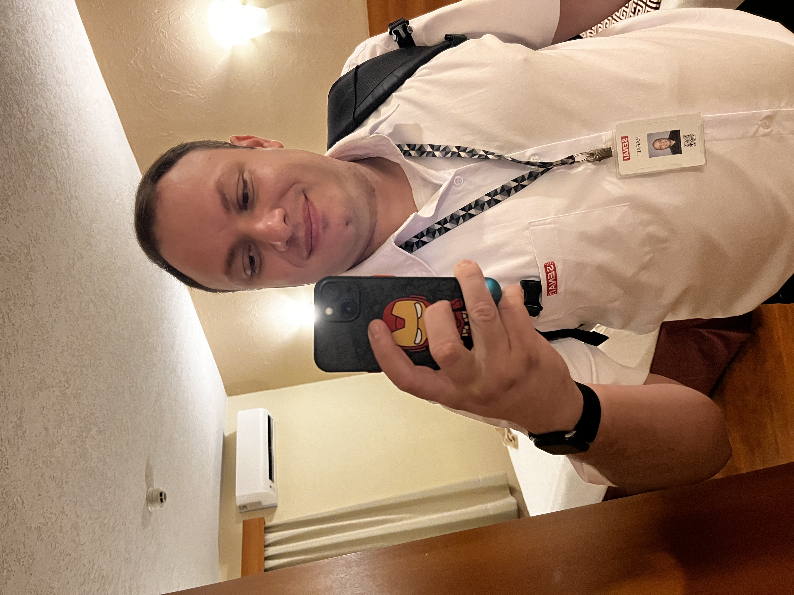

# Rafael Selvagio — Portfólio, Contato & Softwares

<p align="center">
  
</p>

<p align="center">
  <strong>Hub central de contato, perfil profissional e portfólio de soluções digitais.</strong><br>
  Desenvolvido com foco em alta performance, estética tecnológica moderna, microinterações fluidas e responsividade completa.
</p>

<p align="center">
  <a href="https://professor-rafael-selvagio.github.io/contato/" target="_blank">
    
  </a>
  
  
  
</p>

---

## 🌐 Demonstração Online (GitHub Pages)

O projeto está publicado e totalmente funcional através do **GitHub Pages**:

🔗 **Link de Acesso:**  
👉 **[https://professor-rafael-selvagio.github.io/contato/](https://professor-rafael-selvagio.github.io/contato/)**

---

## 📁 Estrutura do Projeto

O projeto foi organizado de forma modular, separando recursos estáticos, folhas de estilo e lógica de scripts:

```text
contato/
├── assets/
│   └── images/
│       └── Rafael.jpeg       # Foto de perfil otimizada
├── src/
│   ├── styles/
│   │   ├── tokens.css        # Design tokens: cores, fontes, sombras, espaçamentos
│   │   └── main.css          # Estilização completa da interface, layout e componentes
│   └── scripts/
│       └── main.js           # Lógica do catálogo, validação de formulário e modal
├── index.html                # Ponto de entrada da aplicação
├── README.md                 # Documentação completa
└── .gitignore                # Arquivos ignorados pelo versionamento
```

---

## 🎨 Identidade Visual & Design System

A interface adota uma estética tecnológica refinada (*dark mode* industrial de precisão), inspirada nos padrões do catálogo interativo do [XR LAB](https://luctrevisan.github.io/portfolio/?f=ar), combinando superfícies escuras com um trio de cores estruturadas:

- **🟢 Verde (`#10b981` / `#00f5a0`):** Cor de destaque principal. Representa inovação, sustentabilidade, tecnologia e estado ativo (*beacon de status*, botões de ação e anéis de foco).
- **🟡 Amarelo (`#fbbf24` / `#f59e0b`):** Elementos estratégicos de atenção e chamadas de destaque (*badges de resposta rápida*, advertências e avisos de obrigatoriedade).
- **🔵 Azul (`#0284c7` / `#38bdf8`):** Transmite estabilidade, confiabilidade técnica e profissionalismo (subtítulos, tags de marketing e detalhes complementares).
- **⬛ Fundo Tecnológico (`#06090e`):** Fundo escuro com malha quadriculada de precisão (*tech grid*) e halos de iluminação ambiente suaves (*ambient glows*).
- **📐 Tipografia:** Combinação de **Manrope** (legibilidade e elegância para títulos e corpo) com **JetBrains Mono** (detalhes técnicos, tags e contadores).
- **⚡ Ícones Vetoriais SVG:** Ícones inline de alta precisão com suporte a `currentColor`, dispensando bibliotecas pesadas e garantindo carregamento instantâneo e offline.

---

## 🚀 Recursos e Componentes

### 1. Barra Superior (*Sticky Topbar*)
- Identidade com foto, nome e especialidade.
- **Status Beacon:** Indicador visual em tempo real com pulso luminoso (*Disponível para contato*).
- Links rápidos de navegação com botão CTA para envio imediato de mensagem.
- Ajuste compacto inteligente para smartphones.

### 2. Painel de Perfil & Canais Diretos
- Avatar em moldura circular com anel luminoso sutil e status online.
- Biografia resumida com pílulas de especialidade (*Inteligência Artificial*, *Docência SENAI*, *Inovação*).
- Botão com animação tátil para rolagem rápida até o catálogo de softwares.
- Cartões individuais para canais de contato:
  - **LinkedIn:** `/in/rafaelselvagio`
  - **GitHub:** `@professor-rafael-selvagio`
  - **E-mail Pessoal:** `professor.rafael.selvagio@gmail.com`
  - **E-mail SENAI:** `rafael.selvagio@docente.senai.br`

### 3. Formulário de Mensagem Direta
- **Integração com Formspree:** Envio dinâmico para `https://formspree.io/f/xzdqbboa`.
- **Suporte Híbrido:** Submissão via **AJAX (Fetch API)** com indicador de carregamento (*spinner*) e fallback transparente para submissão nativa.
- **Validação em Tempo Real:** Feedback visual completo com mensagens de orientação contextual para cada campo (Nome, E-mail e Mensagem).
- **Estados Visuais Suportados:** `Normal`, `Hover`, `Focus`, `Valid`, `Error`, `Loading` e `Disabled`.

### 4. Modal de Confirmação Tecnológico
- Janela de feedback com efeito de desfoque de fundo (*backdrop-blur*).
- Ícone de sucesso animado com aura verde esmeralda.
- Fechamento flexível via botão, clique no overlay ou tecla `Escape`.
- Tratamento limpo de URL (remove `?success=true` via `history.replaceState` sem recarregar a página).

### 5. Catálogo de Softwares & Projetos Desenvolvidos
Filtro dinâmico por categorias com contadores em tempo real e animação de escala e opacidade:
- **Todos os Projetos (6)**
- **Marketing Digital (2)**
- **Cursos (1)**
- **Educação Infantil (1)**
- **Ferramentas Docentes (2)**

#### Softwares listados:
1. **Simulador de Campanha de Marketing:** Simulador com IA para testar estratégias, orçamentos e conversões.
2. **Landing Page de Captura de Dados:** Página para demonstração didática de captação de leads e analytics.
3. **Curso: Programação em Python:** Material interativo e ambiente de aprendizado prático da linguagem.
4. **Sílabas e Formação de Leitura:** Ferramenta lúdica para auxílio na fase de alfabetização infantil.
5. **Gerador de Capa Google Classroom:** Ferramenta para criação e exportação oficial de capas 4:1 com `html2canvas`.
6. **Kahoot! AI Creator (Extensão Chrome):** Extensão para automatização de criação de quizzes e jogos com a API Google Gemini.

---

## 🛠️ Tecnologias Utilizadas

- **HTML5:** Estrutura semântica, acessibilidade e meta tags para Open Graph e mobile.
- **CSS3 Moderno:** 
  - CSS Custom Properties (Design Tokens centralizados no `:root`).
  - CSS Grid & Flexbox responsivos.
  - Efeitos de profundidade com `backdrop-filter: blur()`.
  - Microinterações e animações com curvas de aceleração cúbica (`cubic-bezier`).
- **JavaScript (Vanilla ES6+):** 
  - Filtragem de categorias sem dependências externas.
  - Submissão assíncrona via `fetch()`.
  - Gerenciamento de eventos de teclado e validação regex de formulário.
- **Formspree:** Serviço de backend para roteamento de mensagens do formulário direto para a caixa de entrada.

---

## 💻 Como Executar Localmente

Como o projeto é construído exclusivamente com tecnologias web nativas (HTML, CSS e JS puro), não é necessária nenhuma etapa de build ou instalação de pacotes:

1. **Clone o repositório:**
   ```bash
   git clone https://github.com/professor-rafael-selvagio/contato.git
   cd contato
   ```

2. **Inicie um servidor estático local:**
   - Com Python 3:
     ```bash
     python3 -m http.server 8000
     ```
   - Com Node.js (`npx`):
     ```bash
     npx serve
     ```
   - Ou abra o arquivo `index.html` diretamente em qualquer navegador moderno.

3. **Acesse no navegador:**
   ```text
   http://localhost:8000
   ```

---

## 📱 Responsividade

A interface foi projetada sob o princípio *responsive-first*, garantindo experiência consistente em:
- **Desktop / Telas Ultrawide** (> 1200px)
- **Notebooks e Laptops** (960px - 1199px)
- **Tablets** (601px - 959px)
- **Smartphones** (até 600px)

---

## 👨‍🏫 Autor

**Rafael Selvagio**  
*Instrutor de Formação Profissional & Desenvolvedor*  
- **LinkedIn:** [linkedin.com/in/rafaelselvagio](https://www.linkedin.com/in/rafaelselvagio/)  
- **GitHub:** [github.com/professor-rafael-selvagio](https://github.com/professor-rafael-selvagio)  
- **E-mail:** [professor.rafael.selvagio@gmail.com](mailto:professor.rafael.selvagio@gmail.com)

---

<p align="center">
  <sub>© 2026 Rafael Selvagio • Todos os direitos reservados.</sub>
</p>
